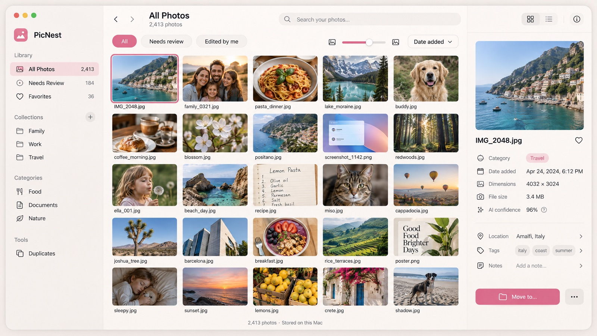
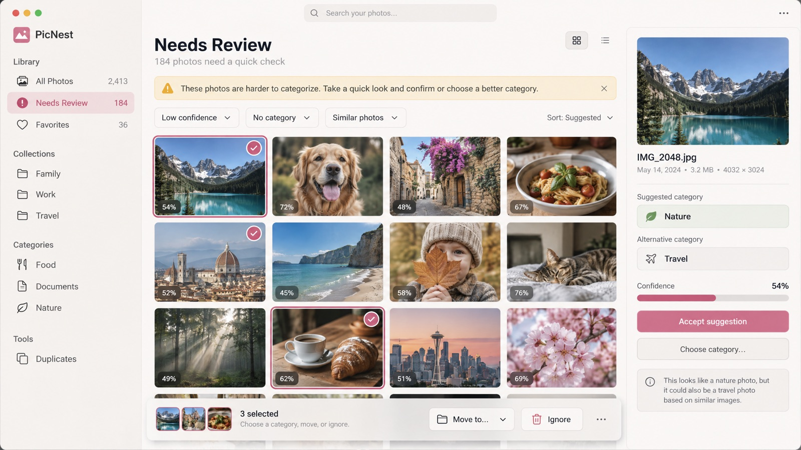
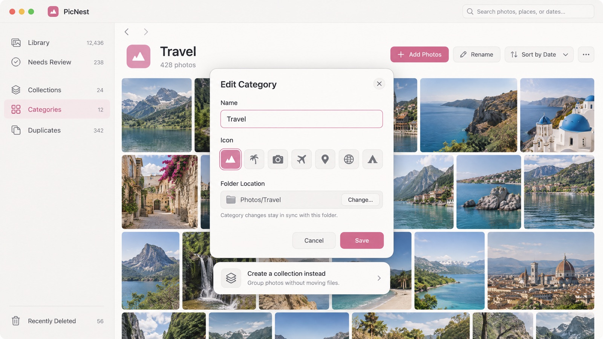
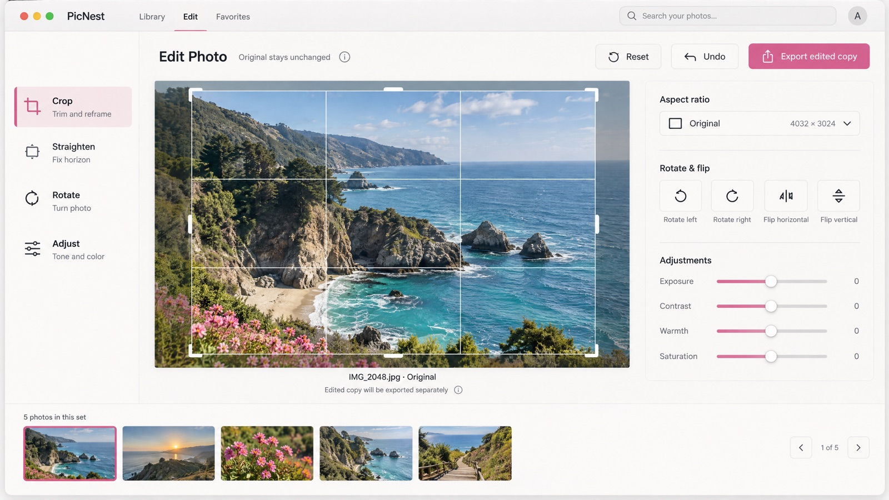
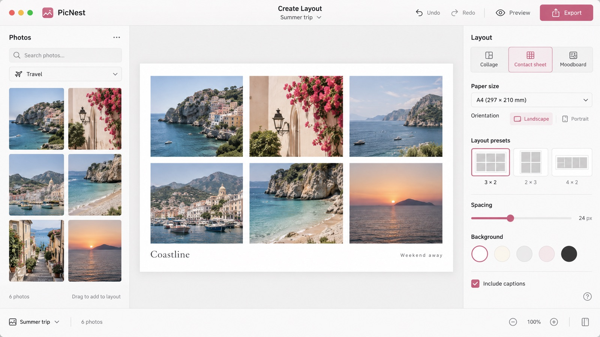

<p align="center">
  
</p>

<h1 align="center">Picnest</h1>

<p align="center"><b>Sort a messy photo folder into clean categories on your Mac.</b><br>On-device AI. No upload. No account. Free and open source.</p>

<p align="center">
  <a href="../../releases/latest"></a>
  <a href="LICENSE"></a>
  
  
  
  <a href="../../stargazers"></a>
</p>

<p align="center">
  <a href="../../releases/latest"><b>Download</b></a> ·
  <a href="#quick-start">Quick start</a> ·
  <a href="#features">Features</a> ·
  <a href="../../issues/new/choose">Give feedback</a> ·
  <a href="#contribute">Contribute</a>
</p>

<p align="center">
  
</p>

<p align="center"><sub>Design mockups. The <a href="#whats-not-in-the-app-yet">list of ideas not in the app yet</a> shows the parts that do not exist today.</sub></p>

## Why Picnest

Your phone and your camera make photos with names like `z7913505267117_a3f.jpg`. After some years, 1 folder holds thousands of them. Finding 1 photo takes a long time.

Picnest looks at each photo and groups the photos by what they show. You then have folders like "Food", "Travel", and "Birthdays". Picnest runs the AI model on your Mac, so your photos stay on your Mac.

- **For people with a large photo folder.** Parents, travelers, students, and anyone with years of unsorted photos.
- **For people who care about privacy.** The app has no account and no cloud. It touches the network only to check for a new version.
- **For people who want control.** You review every suggestion before the app copies or moves 1 file. You can undo the last sort.

## Features

- **Automatic categories.** The app proposes categories with meaningful names, for example "Kids' artwork", "Food", or "Birthdays". It uses Apple MobileCLIP, a model that runs on your Mac with Core ML.
- **Review before sort.** See every photo with its confidence score. Drag a photo to a different category. Rename, merge, and delete categories.
- **Needs review.** The app puts photos with a low score in a separate list. Accept all, accept 1 group, or move photos by hand.
- **Copy or move.** 1 batch sorts all photos. Date sub-folders and new file names (date, category, number) are optional.
- **Undo.** Undo Last Sort puts the folder back the way it was.
- **Category folders.** A new category makes its folder at once. Rename a category and the app renames its folder.
- **Favorites and collections.** Mark photos as favorites. Group photos in collections without moving files.
- **Duplicates.** Find exact copies and similar photos, keep 1, and move the others to the Trash.
- **Photo editor.** Crop, straighten, rotate, flip, and adjust exposure, contrast, warmth, and saturation. The original photo stays unchanged. The app exports an edited copy.
- **Layout editor.** Make contact sheets and collages from your photos. Export a layout as PNG or PDF.
- **Light and dark appearance.** The app speaks English and Vietnamese.
- **Automatic updates.** The app finds new versions with Sparkle and asks you before it installs 1.

## Screenshots

| Review the photos that need a check | Manage categories and folders |
|:---:|:---:|
|  |  |

| Edit a photo, keep the original | Make a contact sheet or a collage |
|:---:|:---:|
|  |  |

## Quick start

Requirements: macOS 15.0 or later, on Apple silicon or Intel.

1. Download `Picnest <version>.dmg` from the [latest release](../../releases/latest).
2. Open the DMG. Drag **Picnest** to **Applications**.
3. Start Picnest from the Applications folder.
4. Drop a folder of photos on the window.

The app does not have an Apple notarization. The first time, macOS shows "Apple could not verify". To open the app:

1. Click **Done**.
2. Open **System Settings > Privacy & Security**.
3. Scroll to the Picnest message and click **Open Anyway**. Type your Mac password.

You do this 1 time only. If you prefer, build the app from the source code yourself. See [Build from source](#build-from-source).

## Use

1. Drop a folder of photos on the window.
2. Wait for the scan. The first start takes longer, because macOS prepares the model.
3. Check the categories. Fix wrong photos and look at **Needs Review**.
4. Click **Sort Photos…**. Select **Copy** or **Move**, then click **Sort**.

By default, the app writes the sorted photos to `<folder> - sorted`, next to the original folder.

## Update

Picnest checks the network 1 time a day for a new version, and asks you before it installs 1. You can also
check by hand: open **Picnest > Check for Updates…**.

You do not download a new DMG or move the app again. Picnest replaces the app in `/Applications` and starts
it again. Your sessions are not changed.

## Privacy

- The AI model runs on your Mac. The app does not upload any photo, name, or score.
- The app has no account, no analytics, and no ads.
- The only network call is the check for a new version. It reads the [appcast file](https://megabuild-dev.github.io/picnest/appcast.xml).
- The app never replaces an original photo with an edited one.
- The code is open. Read it, or build the app yourself.

## What's not in the app yet

The design mockups show some ideas that the app does not have today:

- Photo tags, notes, and location.
- Moodboard layouts.

[docs/specs](docs/specs) explains what the app does and does not do.

## Feedback

Your feedback shapes the app. These actions help the most:

- [Report a bug or ask for a feature](../../issues/new/choose). Give your macOS version and the app version. Do not attach private photos.
- Tell us which kinds of photos the app sorts well, and which kinds it does not.
- Star the repository. A star helps other people find Picnest.
- Tell a friend with a large photo folder.

## Contribute

Bug reports, ideas, translations, and pull requests are welcome. Good places to start:

- Add a language to the string catalog. The app has English and Vietnamese now.
- Improve the category names that the app proposes.
- Add tests to `PicnestCore`.
- Pick an issue with the label `good first issue`.

Read [CONTRIBUTING.md](CONTRIBUTING.md) first. This project follows the [Code of Conduct](CODE_OF_CONDUCT.md).

## Build from source

You need Xcode 16 or later. You do not need a paid Apple Developer account.

```bash
git clone https://github.com/megabuild-dev/picnest.git
cd picnest
scripts/fetch-models.sh s2   # downloads the model (about 200 MB)
open Picnest.xcodeproj       # then click Run
```

To make a DMG, run `scripts/make-dmg.sh`. [BUILD.md](BUILD.md) has all the build, test, and release steps.

## Command-line tool

If you prefer the terminal, [classifyimages](https://github.com/megabuild-dev/classifyimages) is a Python tool with the same file rules. It sorts a folder with an editable `categories.yaml`.

## Project layout

| Path | Contents |
|------|----------|
| `Picnest/` | The SwiftUI app: views and view models |
| `PicnestCore/` | Swift package: domain types, repositories, and services, with their tests |
| `PicnestTests/` | App tests |
| `scripts/` | Model download, DMG, and appcast scripts |
| `docs/` | Specifications, plans, project terms, and images |

## License

The code is under the [MIT License](LICENSE).

The MobileCLIP model files and the CLIP vocabulary have their own licenses. See [THIRD_PARTY_NOTICES.md](THIRD_PARTY_NOTICES.md). Picnest is not made or endorsed by Apple.
