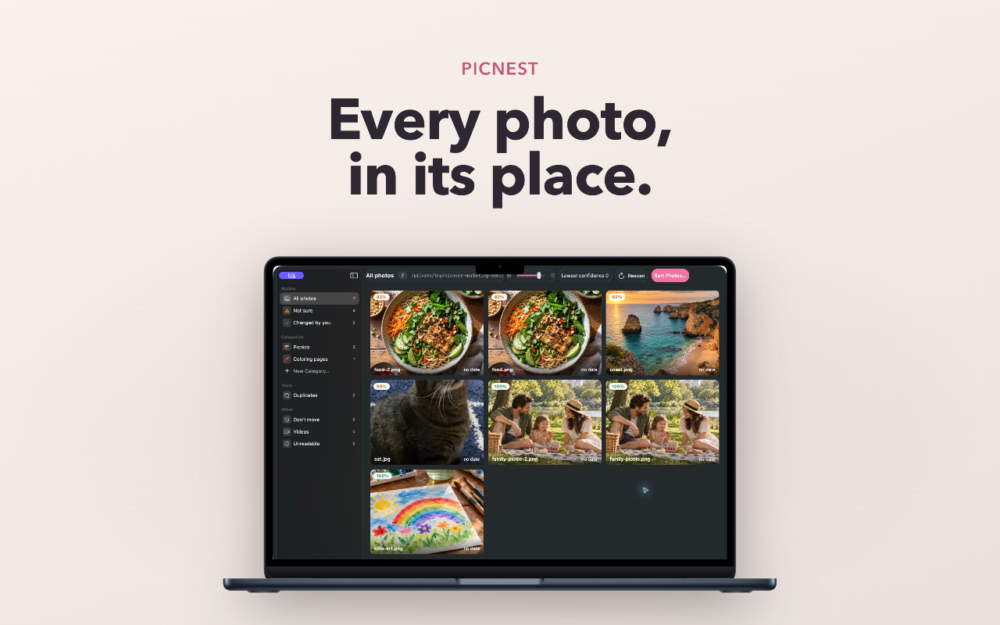
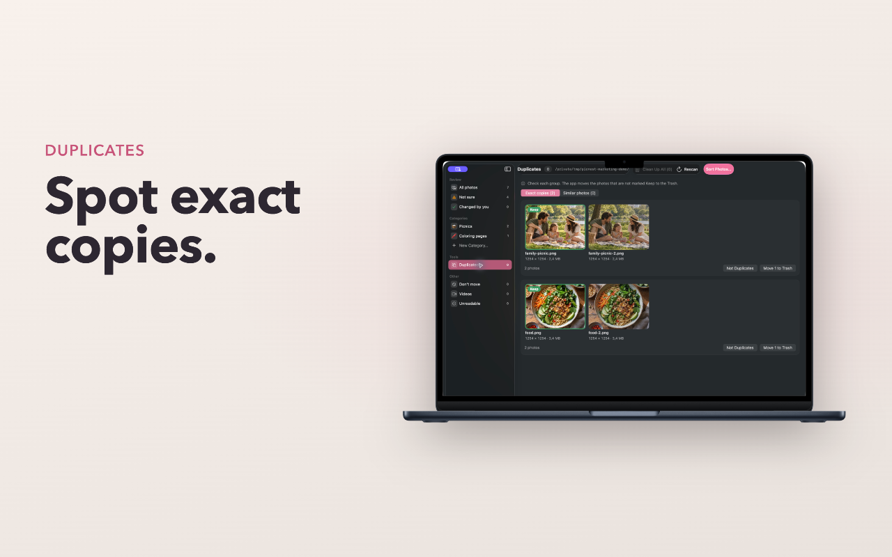
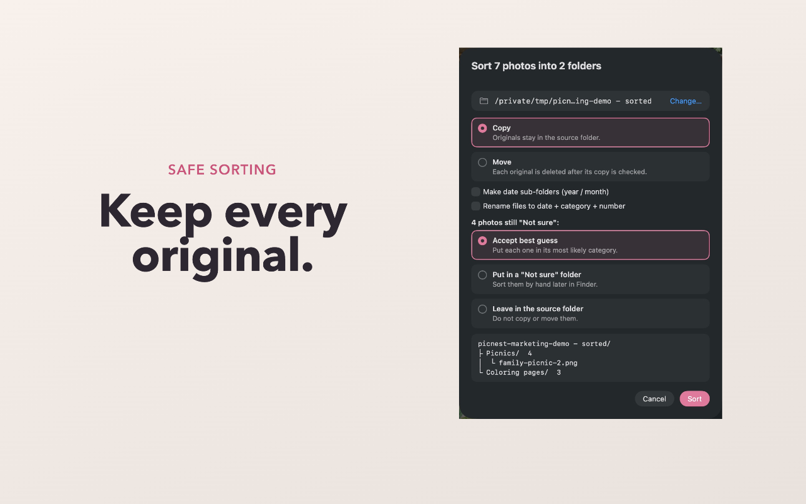

<p align="center">
  
</p>

<h1 align="center">Picnest</h1>

<p align="center">Picnest sorts a messy folder of photos into category folders. It runs on your Mac. Your photos never leave your computer.</p>

<p align="center">
  
</p>

Point it at a folder of photos with names like `z7913505267117_a3f.jpg`. The app looks at each photo with an on-device AI model (Apple MobileCLIP), proposes categories with clear names, and lets you fix any photo before it copies or moves the files.

## Features

- **Automatic categories.** The app proposes categories with meaningful names, for example "Kids' artwork", "Food", or "Birthdays".
- **Review before sort.** See every photo. Drag a photo to a different category, or rename, merge, and delete categories.
- **Not sure.** The app puts photos with a low score in "Not sure". Accept all, accept 1 group, or move photos by hand.
- **Copy or move.** 1 batch sorts all photos. Date sub-folders and new file names (date, category, number) are optional.
- **Undo.** Undo Last Sort puts the folder back the way it was.
- **Duplicates.** Find exact copies and similar photos, keep 1, and move the others to the Trash.
- **Private.** No account, no upload. The app touches the network only to check for a new version.

## Screenshots

| Review every suggestion | Spot exact copies | Keep every original |
|:---:|:---:|:---:|
|  |  |  |

## Install

Requirements: macOS 15.0 or later, on Apple silicon or Intel.

1. Download `Picnest <version>.dmg` from the [latest release](../../releases/latest).
2. Open the DMG. Drag **Picnest** to **Applications**.
3. Start Picnest from the Applications folder.

The app does not have an Apple notarization. The first time, macOS shows "Apple could not verify". To open the app:

1. Click **Done**.
2. Open **System Settings > Privacy & Security**.
3. Scroll to the Picnest message and click **Open Anyway**. Type your Mac password.

You do this 1 time only. If you prefer, build the app from the source code yourself. See [Build from source](#build-from-source).

## Update

Picnest checks the network 1 time a day for a new version, and asks you before it installs 1. You can also
check by hand: open **Picnest > Check for Updates…**.

You do not download a new DMG or move the app again. Picnest replaces the app in `/Applications` and starts
it again. Your sessions are not changed.

## Use

1. Drop a folder of photos on the window.
2. Wait for the scan. The first start takes longer, because macOS prepares the model.
3. Check the categories. Fix wrong photos and look at **Not sure**.
4. Click **Sort Photos…**. Select **Copy** or **Move**, then click **Sort**.

By default, the app writes the sorted photos to `<folder> - sorted`, next to the original folder.

## Build from source

You need Xcode 16 or later. You do not need a paid Apple Developer account.

```bash
git clone https://github.com/megabuild-dev/picnest.git
cd picnest
scripts/fetch-models.sh s2   # downloads the model (about 200 MB)
open Picnest.xcodeproj       # then click Run
```

To make a DMG, run `scripts/make-dmg.sh`. [BUILD.md](BUILD.md) has all the build, test, and release steps.

## Command-line tool

If you prefer the terminal, [classifyimages](https://github.com/megabuild-dev/classifyimages) is a Python tool with the same file rules. It sorts a folder with an editable `categories.yaml`.

## Project layout

| Path | Contents |
|------|----------|
| `Picnest/` | The SwiftUI app: views and view models |
| `PicnestCore/` | Swift package: domain types, repositories, and services, with their tests |
| `PicnestTests/` | App tests |
| `scripts/` | Model download and DMG scripts |
| `docs/` | Specification, plans, and project terms |

## Contribute

Bug reports, ideas, and pull requests are welcome. Read [CONTRIBUTING.md](CONTRIBUTING.md) first. This project follows the [Code of Conduct](CODE_OF_CONDUCT.md).

## License

The code is under the [MIT License](LICENSE).

The MobileCLIP model files and the CLIP vocabulary have their own licenses. See [THIRD_PARTY_NOTICES.md](THIRD_PARTY_NOTICES.md). Picnest is not made or endorsed by Apple.
